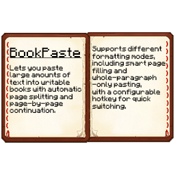

# BookPaste



Paste long texts into Minecraft books and signs with automatic formatting and page splitting.

**Fabric / NeoForge | Version 2.2 | By SvyatON**

[Download on Modrinth](https://modrinth.com/mod/bookpaste) | [Download on CurseForge](https://www.curseforge.com/minecraft/mc-mods/bookpaste)

<br clear="right">

## Features

- Automatic page splitting for books and word wrapping for signs.
- Smart wrapping or whole-paragraph formatting.
- Unfinished text stays in your clipboard when there is no more space.
- Custom page limits for singleplayer and servers.
- Notifications above the hotbar, Scribble and Scholar adapters, and 9 languages.

## Getting started

For **Fabric**, install Fabric API and add Mod Menu to access the settings. For **NeoForge**, no additional dependency is needed; open the settings from the Mods screen. Use the BookPaste JAR matching your loader and Minecraft version.

Open a writable book or sign and press **Ctrl+V**. Press **F8** to switch formatting modes; the hotkey is configurable.

## Minecraft versions

Choose the matching range when downloading. One JAR covers the whole listed range: for example, **1.16.4 uses the 1.16.2-1.16.5 JAR**.

| Minecraft | Fabric JAR ranges |
|---|---|
| 1.16 | 1.16-1.16.1, 1.16.2-1.16.5 |
| 1.17 | 1.17-1.17.1 |
| 1.18 | 1.18-1.18.1, 1.18.2 |
| 1.19 | 1.19-1.19.2, 1.19.3, 1.19.4 |
| 1.20 | 1.20-1.20.1, 1.20.2-1.20.4, 1.20.5-1.20.6 |
| 1.21 | 1.21-1.21.4, 1.21.5-1.21.8, 1.21.9-1.21.10, 1.21.11 |
| 26.1 | 26.1-26.1.2 |
| 26.2 | 26.2 |
| 26.3 | 26.3 |

The NeoForge port covers **1.21-1.21.1** with one JAR. Minimum NeoForge: **21.0.0-beta** for 1.21, **21.1.1** for 1.21.1. Requires Java 21. Forge is planned.

## Page settings

In singleplayer, set your page limit through the settings screen. Disabling the custom limit restores 100 pages; enabling it again restores your last value.

To use more than 100 pages on a server, install BookPaste on both the server and clients. Fabric also requires Fabric API; NeoForge needs no extra dependency. The same JAR works on either side. Server settings are read-only in the client menu and do not overwrite personal settings.

<details>
<summary>Server configuration</summary>

Edit `config/bookpaste.json` and restart the server. Only these two fields are needed on the server:

```json
{
  "customBookPages": true,
  "maxPages": 750
}
```

`false` restores 100 pages. With the custom limit enabled, `maxPages: 0` removes the BookPaste page cap. Negative values are rejected. The generated config includes `#` comments explaining all fields.

If a book exceeds a reduced limit, BookPaste blocks saving or signing and shows a warning without cutting pages. Minecraft's packet and NBT size limits still apply.

</details>

## Building

Use **JDK 25**. From the repository root on Windows:

```powershell
.\gradlew.bat :26.3-fabric:build
.\gradlew.bat :1.21.1-neoforge:build
.\gradlew.bat buildAll --continue
```

The first two commands build individual targets; `buildAll` builds all 18 Fabric targets and the NeoForge target through Stonecutter. On Linux and macOS, replace `.\gradlew.bat` with `bash ./gradlew`. The first build downloads its dependencies.

Mod JARs are collected in **`build/fabric/`** and **`build/neoforge/`**. Source archives go in the `sources/` subfolder for each loader. GitHub contains the buildable source; compiled releases are available on Modrinth and CurseForge.

## License

[Apache License 2.0](LICENSE) | [NOTICE](NOTICE)
